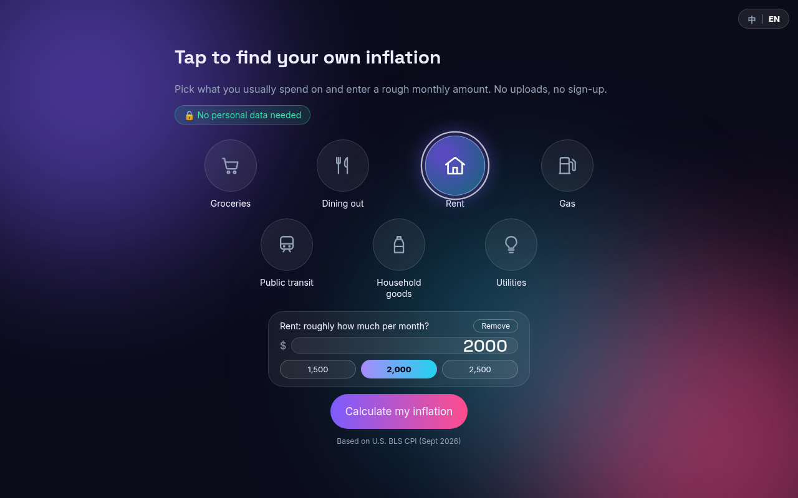
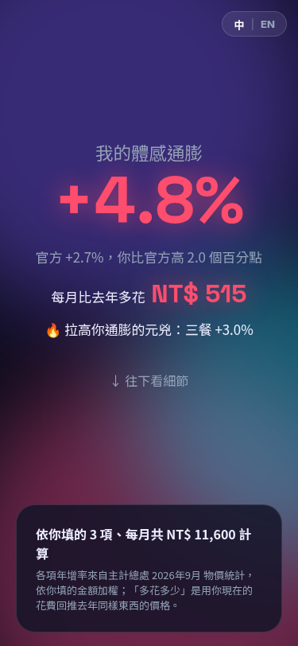
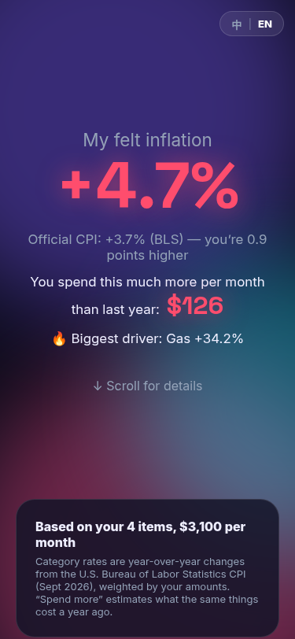

<div align="center">

# 體感通膨儀表板 · My Inflation

**選你常花的項目、填大概金額，30 秒算出「你自己的」通膨率，以及每月比去年多花多少錢。**<br>
**Pick what you spend on, enter rough monthly amounts, and see your own inflation rate — plus how much more you pay each month than last year.**

[](https://jasper31943.github.io/inflation-tracker/)
[](LICENSE)
[](#隱私--privacy)
[](#運作原理)

[繁體中文](#繁體中文) · [English](#english)

🇹🇼 **[中文版（台灣）](https://jasper31943.github.io/inflation-tracker/)** &nbsp;|&nbsp; 🇺🇸 **[English (US)](https://jasper31943.github.io/inflation-tracker/en/)**



 &nbsp; 

</div>

---

## 繁體中文

官方 CPI 是「全國平均」，但每個人的花費組合都不一樣：天天騎車通勤的人和搭捷運的人，感受到的漲價可能差很多。這個小工具用官方公布的各分類物價年增率，依**你自己的花費比重**加權，算出屬於你的通膨率。

### 線上試用

| 版本 | 網址 | 資料 | 幣別 |
|---|---|---|---|
| 中文（台灣） | https://jasper31943.github.io/inflation-tracker/ | 行政院主計總處 CPI | NT$ |
| English（美國） | https://jasper31943.github.io/inflation-tracker/en/ | U.S. BLS CPI-U | US$ |

### 功能

- 🫧 **泡泡選項目**：點選你常花錢的分類（台灣 7 類、美國 7 類）。
- ✏️ **填每月大概金額**：可自行輸入，或點常見金額快速選擇（例如房租 NT$ / $ 的三個參考值）。
- 📈 **個人體感通膨率**：並與官方整體 CPI 比較，標示你比官方高或低幾個百分點。
- 💸 **每月多花多少**：估算同樣的東西，你現在每月比去年多付的金額。
- 🔥 **元兇**：找出對你通膨貢獻最大的分類，並列出各項年增率。
- 🖼️ **分享圖卡**：在瀏覽器內用 canvas 產生 1080×1920 直式圖卡，可直接下載分享。
- 🌐 **中 | EN 切換**：右上角切換語言，同時切換資料集與幣別。
- 🧭 **自動語言**：依瀏覽器語言預設（`en*` → 英文），並記住你的選擇（localStorage）。
- 🔗 **`?lang=en` / `?lang=zh`**：網址參數直接指定語言；`/en/` 會導向 `?lang=en`。
- 🇹🇼🇺🇸 **兩套資料**：台灣用主計總處、美國用 BLS，分類與常見金額各自在地化。
- 🔒 **隱私**：沒有後端、沒有帳號、沒有追蹤；你填的金額只在瀏覽器裡計算，不會上傳。

### 運作原理

設你選了 $n$ 個分類，第 $i$ 類每月金額為 $w_i$、官方年增率為 $r_i$（小數）。

**個人通膨率**＝以你的金額加權的各分類年增率平均：

$$
r_{\text{personal}} = \frac{\sum_i w_i \, r_i}{\sum_i w_i}
$$

**每月多花**＝現在的花費減去「同樣東西去年的價格」：

$$
\Delta = \sum_i \left( w_i - \frac{w_i}{1 + r_i} \right) = \sum_i w_i \cdot \frac{r_i}{1 + r_i}
$$

金額為 0 的項目不列入計算；「元兇」為 $w_i \, r_i$ 最大的分類。所有計算都在 `index.html` 的前端 JavaScript 內完成。

### 資料來源

#### 台灣：行政院主計總處 CPI，2026 年 9 月（115 年 9 月，2026-10-07 發布）

來源：[115年9月物價新聞稿](https://www.stat.gov.tw/News_Content.aspx?n=3703&s=236759)（表1、表2、表14）。官方整體 CPI 年增率：**2.73%**。權數為 113 年基期結構（‰）。

| 泡泡 | 對應官方分類 | 年增率 | 權數（‰） |
|---|---|---:|---:|
| 🍱 三餐 | 外食費 | 3.04% | 105.88 |
| 🧋 飲料 | 在外點用之咖啡、飲料 | 1.72% | 7.577 |
| 🏠 房租 | 房租 | 1.72% | 148.67 |
| ⛽ 油錢 | 油料費 | 12.72% | 22.27 |
| 🚇 大眾運輸 | 捷運車票、火車票、客運汽車票（加權） | −0.17% | 7.486 |
| 🧻 日用品 | 衛生紙、清潔劑、清潔用具、其他家用品（加權） | 4.16% | 15.522 |
| 💡 水電瓦斯 | 水電燃氣 | 4.63% | 16.658 |

#### 美國：BLS CPI-U，2026 年 9 月（U.S. city average，未季調）

年增率＝2026 年 9 月指數對 2025 年 9 月指數；權數＝[2025 年 12 月相對重要性](https://www.bls.gov/cpi/tables/relative-importance/2025.htm)（占 CPI-U %）。官方整體 CPI（All items, `CUUR0000SA0`）年增率：**3.74%**。

| Bubble | BLS 分類 | Series ID | 年增率 | 權重（%） |
|---|---|---|---:|---:|
| 🛒 Groceries | Food at home | `CUUR0000SAF11` | 1.81% | 8.325 |
| 🍽️ Dining out | Food away from home | `CUUR0000SEFV` | 3.46% | 5.373 |
| 🏠 Rent | Rent of primary residence | `CUUR0000SEHA` | 2.78% | 7.840 |
| ⛽ Gas | Gasoline (all types) | `CUUR0000SETB01` | 34.17% | 2.895 |
| 🚌 Public transit | Public transportation | `CUUR0000SETG` | 15.57% | 1.485 |
| 🧴 Household goods | Housekeeping supplies | `CUUR0000SEHN` | 1.19% | 0.847 |
| 💡 Utilities | Household energy | `CUUR0000SAH21` | 6.16% | 3.402 |

### 注意事項

- 「三餐」對應官方「外食費」，其中已含在外點用飲料；若同時選「飲料」，飲料部分會有些微重複計算。
- 「大眾運輸」「日用品」是多個官方查價項目依官方權數加權平均，並非官方直接公布的單一數字；「水電瓦斯」權數由電費、燃氣、家庭用水權數相加。
- 年增率是「分類平均」，不代表你實際買到的品牌或店家價格。
- 本工具僅供參考與討論，**不構成任何財務或投資建議**。

### 專案結構

```
inflation-tracker/
├── index.html        # 單頁應用：介面、樣式、計算、分享圖卡、語言切換
├── data.js           # 台灣資料（window.CPI_DATA）
├── data-us.js        # 美國資料（window.CPI_DATA_US）
├── en/index.html     # 英文入口：英文 OG 標籤，並導向 ../?lang=en
├── og-zh.png         # 中文社群預覽圖（1200×630）
├── og-en.png         # 英文社群預覽圖（1200×630）
├── docs/             # README 截圖
├── LICENSE
└── README.md
```

### 本機執行

純靜態網站，不需要安裝任何套件：

```bash
git clone https://github.com/Jasper31943/inflation-tracker.git
cd inflation-tracker
python3 -m http.server 8000
# 開啟 http://localhost:8000/  （英文版：http://localhost:8000/?lang=en）
```

### 每月更新資料

1. **台灣**：主計總處每月上旬發布物價新聞稿。從表1／表2／表14 取得各分類年增率，更新 `data.js` 的 `rate`、`period`、`official` 與 `source`（權數通常不變，基期調整時才更新）。
2. **美國**：BLS 每月中旬發布 CPI。用 [BLS Public API](https://api.bls.gov/publicAPI/v1/timeseries/data/) 抓上表各 Series ID 的當月與去年同月指數，計算年增率，更新 `data-us.js` 的 `rate`、`period`、`official`。權重於 BLS 發布新年度相對重要性時更新。
3. 不確定的數字請保留 `rate: null`，畫面會顯示「資料待補 / Data pending」，不要放猜測值。
4. 本機以 `python3 -m http.server` 檢查兩種語言，再 commit 推到 `main`，GitHub Pages 會自動部署。

### 技術

- 原生 HTML / CSS / JavaScript，無框架、無建置步驟、無相依套件
- GitHub Pages 託管，**零成本**
- 分享圖卡以 Canvas API 在瀏覽器內產生

### 未來規劃

- 加入更多分類（例如醫療、教育）
- 顯示歷史月份的趨勢
- 自動化每月資料更新流程

### 授權

[MIT](LICENSE) © 2026 Jasper Lin

---

## English

The official CPI is a national average, but everyone's basket is different: someone who drives every day can feel a very different inflation than someone who takes the bus. This tool takes official category-level year-over-year price changes and weights them by **your own spending** to give you a personal inflation rate.

### Live demo

| Version | URL | Data | Currency |
|---|---|---|---|
| English (US) | https://jasper31943.github.io/inflation-tracker/en/ | U.S. BLS CPI-U | US$ |
| 中文 (Taiwan) | https://jasper31943.github.io/inflation-tracker/ | DGBAS (Taiwan) CPI | NT$ |

### Features

- 🫧 **Bubble picker** — tap the categories you spend on (7 for the US, 7 for Taiwan).
- ✏️ **Monthly amounts** — type a rough amount or tap a common preset (e.g. rent $1,500 / $2,000 / $2,500).
- 📈 **Personal inflation rate** — compared with the official headline CPI, showing how many points above or below you are.
- 💸 **Extra spending per month** — how much more you pay now than the same things cost a year ago.
- 🔥 **Biggest driver** — the category contributing most to your rate, plus a list of each category's YoY change.
- 🖼️ **Share card** — a 1080×1920 portrait image generated in the browser with canvas, ready to download.
- 🌐 **中 | EN switch** — switches language, dataset and currency together.
- 🧭 **Auto language** — defaults from your browser language (`en*` → English) and remembers your choice in localStorage.
- 🔗 **`?lang=en` / `?lang=zh`** — force a language via URL; `/en/` redirects to `?lang=en`.
- 🇺🇸🇹🇼 **Two datasets** — BLS for the US, DGBAS for Taiwan, each with localized categories and presets.
- 🔒 **Privacy** — no backend, no accounts, no tracking. Your amounts are computed in your browser and never uploaded.

### How it works

For each selected category $i$ with monthly amount $w_i$ and official YoY change $r_i$ (as a decimal):

$$
r_{\text{personal}} = \frac{\sum_i w_i \, r_i}{\sum_i w_i}
\qquad
\Delta_{\text{monthly}} = \sum_i w_i \cdot \frac{r_i}{1 + r_i}
$$

$\Delta$ is today's spending minus what the same items would have cost a year ago ($w_i / (1+r_i)$). Zero amounts are ignored; the "biggest driver" is the category with the largest $w_i \, r_i$. Everything runs client-side in `index.html`.

### Data sources

**US — BLS CPI-U, Sept 2026** (U.S. city average, not seasonally adjusted). YoY = Sept 2026 index vs Sept 2025 index. Weights = [relative importance, Dec 2025](https://www.bls.gov/cpi/tables/relative-importance/2025.htm). Headline (All items, `CUUR0000SA0`): **3.74%**.

| Bubble | BLS category | Series ID | YoY | Weight (%) |
|---|---|---|---:|---:|
| 🛒 Groceries | Food at home | `CUUR0000SAF11` | 1.81% | 8.325 |
| 🍽️ Dining out | Food away from home | `CUUR0000SEFV` | 3.46% | 5.373 |
| 🏠 Rent | Rent of primary residence | `CUUR0000SEHA` | 2.78% | 7.840 |
| ⛽ Gas | Gasoline (all types) | `CUUR0000SETB01` | 34.17% | 2.895 |
| 🚌 Public transit | Public transportation | `CUUR0000SETG` | 15.57% | 1.485 |
| 🧴 Household goods | Housekeeping supplies | `CUUR0000SEHN` | 1.19% | 0.847 |
| 💡 Utilities | Household energy | `CUUR0000SAH21` | 6.16% | 3.402 |

**Taiwan — DGBAS CPI, Sept 2026** ([press release, published 2026-10-07](https://www.stat.gov.tw/News_Content.aspx?n=3703&s=236759)). Headline: **2.73%**. See the [Chinese table above](#台灣行政院主計總處-cpi2026-年-9-月115-年-9-月2026-10-07-發布) for category mapping and values (food away from home 3.04%, fuel 12.72%, public transport −0.17%, etc.).

### Caveats

- Taiwan's "三餐" (meals) maps to *food away from home*, which already includes drinks bought out, so selecting "飲料" (drinks) as well double-counts slightly.
- Some categories are combined: Taiwan's public transport and household goods are weighted averages of several official items, not single published figures.
- Category averages don't reflect the specific brands or stores you buy from.
- For information and discussion only — **not financial advice**.

### Project structure

```
index.html      single-page app: UI, styles, calculation, share card, language switch
data.js         Taiwan dataset (window.CPI_DATA)
data-us.js      US dataset (window.CPI_DATA_US)
en/index.html   English entry: English OG tags, redirects to ../?lang=en
og-zh.png       Chinese social preview (1200×630)
og-en.png       English social preview (1200×630)
docs/           README screenshots
LICENSE, README.md
```

### Run locally

```bash
git clone https://github.com/Jasper31943/inflation-tracker.git
cd inflation-tracker
python3 -m http.server 8000
# open http://localhost:8000/?lang=en
```

### Monthly data update

1. **US**: after BLS publishes CPI (mid-month), fetch the current and year-ago index for each series ID above via the [BLS Public API](https://api.bls.gov/publicAPI/v1/timeseries/data/), compute YoY, and update `rate`, `period`, `official` in `data-us.js`.
2. **Taiwan**: after DGBAS publishes its monthly press release (early month), update `rate`, `period`, `official`, `source` in `data.js` from tables 1/2/14.
3. Leave `rate: null` for anything unconfirmed — the UI shows "Data pending". Never guess.
4. Check both languages locally, then push to `main`; GitHub Pages redeploys automatically.

### Tech stack

Vanilla HTML/CSS/JavaScript (no framework, no build step, no dependencies) · Canvas API for the share card · GitHub Pages hosting · zero cost.

### Roadmap

- More categories (e.g. healthcare, education)
- Historical trend view
- Automated monthly data refresh

### License

[MIT](LICENSE) © 2026 Jasper Lin
